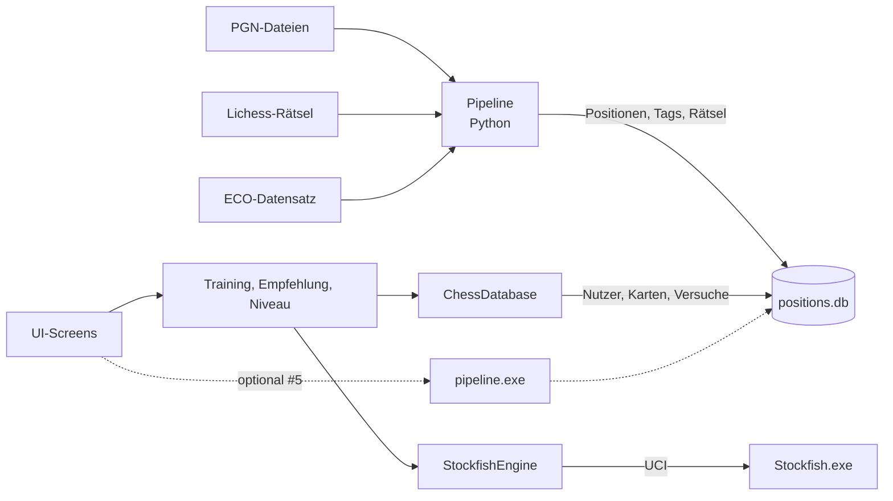

# Architektur

Entscheidung aus Issue #32, mit Yohannes abgestimmt am 10.11.2026.

## Varianten

**A: alles in C# in Unity.** Oberfläche, SQLite, Stockfish, PGN-Import und Tagging sind alle in Unity.
- Vorteile: eine Sprache, ein Build, keine Schnittstelle zwischen Programmen.
- Nachteile: In C# gibt es keine Bibliothek, die so gut ist wie python-chess. PGN-Parser, Tagging, ECO-Erkennung und Lichess-Import müssten wir neu schreiben. Große Importe, etwa die Lichess-Rätsel, sind im Unity-Editor mühsam.

**B: Unity für die App, Python für die Daten.** Unity ist die App mit Oberfläche, Schachlogik, Stockfish und Trainingsregeln. Python importiert und taggt PGNs und Rätsel und schreibt sie in die SQLite-Datenbank.
- Vorteile: python-chess nimmt uns viel Arbeit ab. Tagger, ECO-Buch und Import aus dem Prototyp können wir fast direkt übernehmen. Die Pipeline lässt sich ohne Unity entwickeln und testen.
- Nachteile: zwei Sprachen. Das Datenbankschema muss für beide passen. Falls wir den PGN-Import in der App machen (#5), muss die Pipeline als exe mitgeliefert werden.

Wir nehmen **B**. Die Python-Teile gibt es schon im Prototyp, und zur Laufzeit wird kein Python gebraucht: Der Build bekommt eine fertig befüllte Datenbank mit.

## Komponenten

| Teil | Sprache | Issues | Wer |
|---|---|---|---|
| Pipeline (`pipeline/`) | Python | #2, #33, #36, #44, #50, optional #5, #29, #30 | Simon |
| Datenbank (`db/schema.sql`) | SQLite | #1 | Simon |
| Backend in Unity (`Scripts/Data`, `Engine`, `Training`) | C# | #3, #6, #7, #11, #14, #18, #19, #20, #24, #25, #42 | Simon |
| Frontend in Unity (`Scripts/UI`, `Chess`) | C# | #4, #8–#10, #12, #13, #15–#17, #21–#23, #26, #27, #31 | Yohannes |

Die UI ruft nur die Backend-Klassen auf (z. B. `TrainingService`, `ChessDatabase`) und schreibt selbst kein SQL.

## Schnittstellen

### Datenbank `positions.db`

`db/schema.sql` gilt für beide Seiten. Wer das Schema ändert, sagt es dem anderen. Die Schema-Version steht in `PRAGMA user_version`, und die App prüft sie beim Start.

| Tabellen | schreibt | liest |
|---|---|---|
| `position`, `tag`, `position_tag`, `raetsel`, `partie`, `partie_position` | Pipeline | App |
| `nutzer`, `karte`, `versuch`, `repertoire_eintrag` | App | App |

`best_move` und `evaluation` in `position` füllt entweder die Pipeline vorab oder die App bei Bedarf über Stockfish (#19).

Die Datenbank läuft im WAL-Modus. Wo sie liegt:
- Beim Entwickeln: `db/positions.db`. Sie ist nicht im Repo und wird mit der Pipeline erzeugt.
- Im Build: `StreamingAssets/positions.db`. Sie wird beim ersten Start nach `Application.persistentDataPath` kopiert.
- Mit `-db <pfad>` oder der Umgebungsvariable `CHESS_TRAINER_DB` lässt sich ein anderer Pfad angeben.

### Pipeline-Aufruf

```
python -m pipeline init-db         --db <pfad>
python -m pipeline import-pgn      --db <pfad> --file <datei.pgn> [--user <id>]
python -m pipeline import-puzzles  --db <pfad> --file <lichess_db_puzzle.csv.zst> [--limit N]
python -m pipeline build-demo-db   --out <pfad>
```

Ausgabe auf stdout ist eine JSON-Zeile pro Meldung:

```
{"type": "progress", "done": 120, "total": 500}
{"type": "result", "games": 500, "positions": 38211, "skipped": 3}
{"type": "error", "message": "Datei nicht gefunden: x.pgn"}
```

Exit-Codes: 0 = ok, 1 = Fehler in den Eingabedaten, 2 = interner Fehler.

Die App ruft die Pipeline nur beim optionalen PGN-Import (#5) auf. Sie wird dafür mit PyInstaller zu `pipeline.exe` gepackt und nach `StreamingAssets/pipeline/` gelegt.

### Stockfish

Die App startet Stockfish als eigenen Prozess und spricht über stdin/stdout UCI mit ihm (`position fen ...`, `go depth N`, `bestmove`). Pro Sitzung läuft ein Prozess.

## Übersicht


